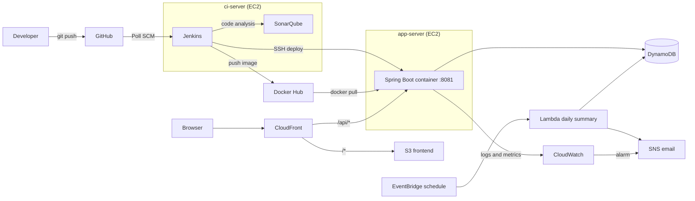
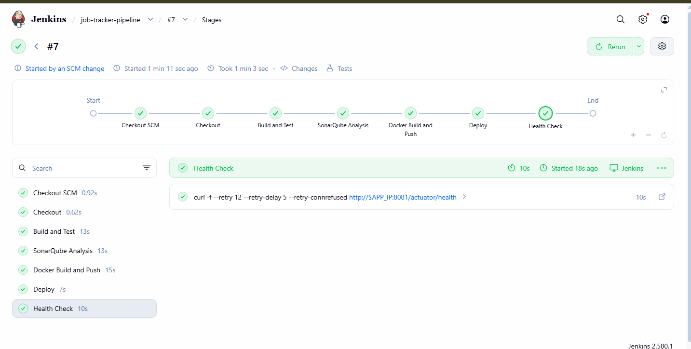
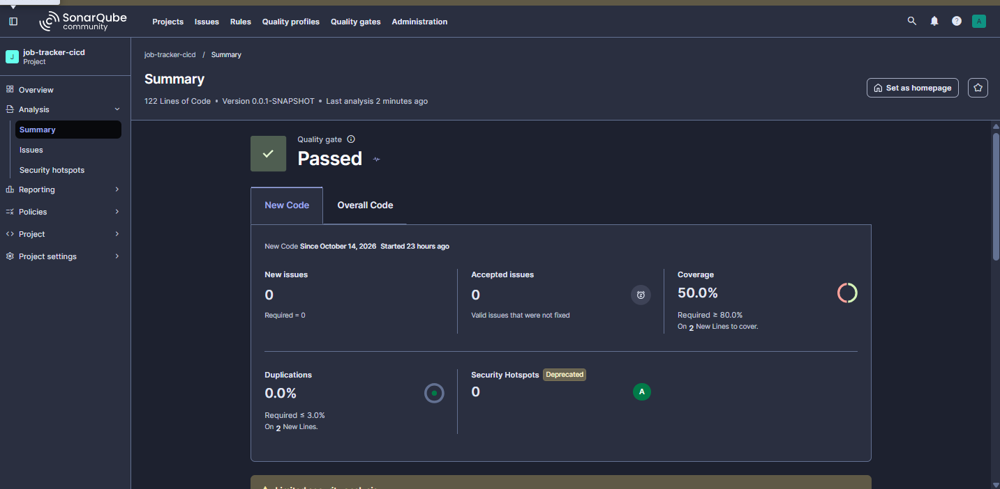
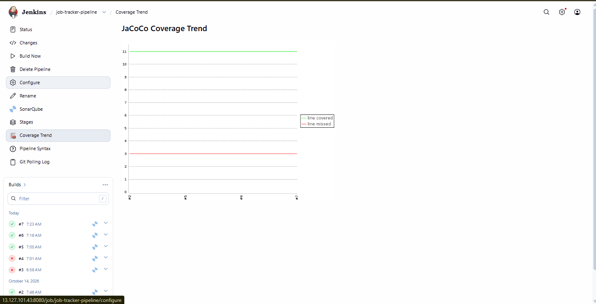
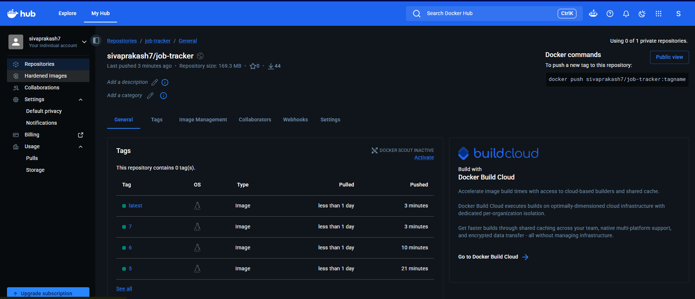
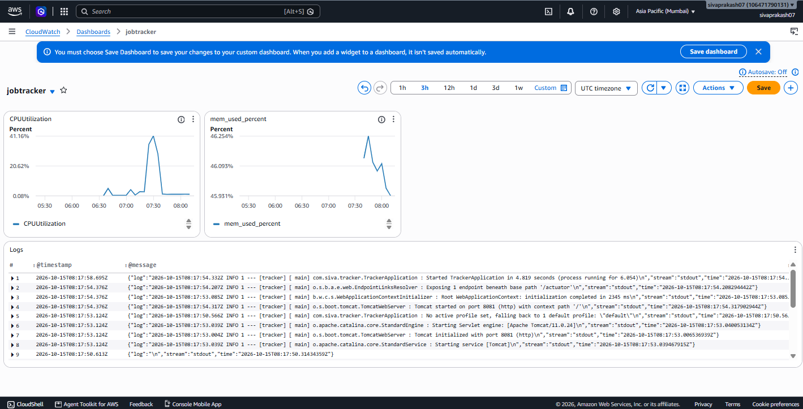
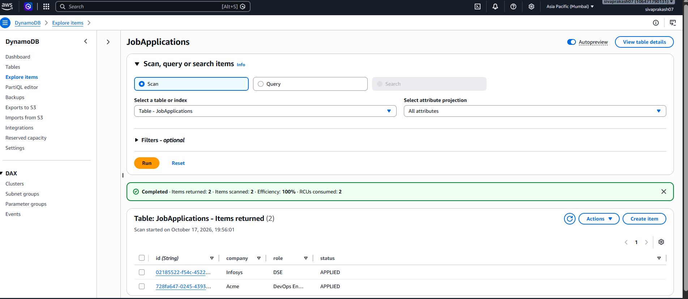
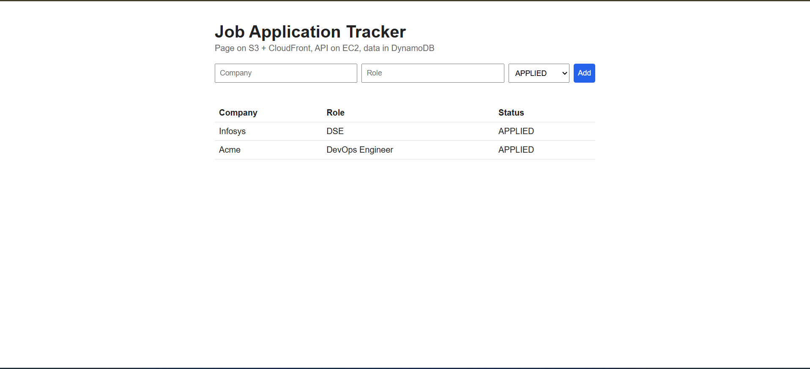
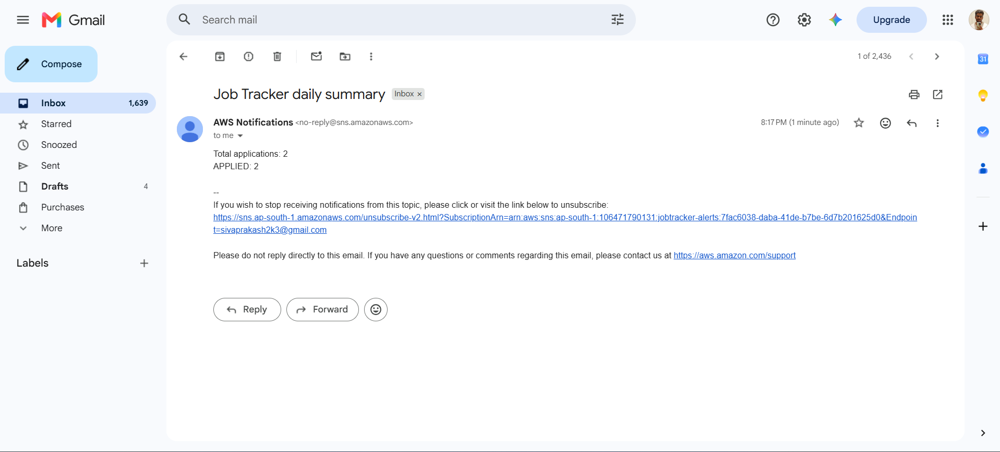

# Job Tracker: End-to-End CI/CD Pipeline on AWS

A Java (Spring Boot) application deployed through a fully automated pipeline: a `git push` triggers build, tests, code-quality analysis, a Docker image build, and a deployment to AWS EC2, with the data stored in DynamoDB, the page served through S3 + CloudFront, and monitoring in CloudWatch.

> The point of this project is the pipeline and the AWS infrastructure around a small application, not the application itself.

**Live demo:** https://d1eun9oaos5zh8.cloudfront.net/
The servers are stopped when not in use to save cost, so the demo may show an `HTTP 504` error while the API is offline.

## Architecture



## Pipeline stages

| Stage | What it does |
|---|---|
| Checkout | Pulls the latest code from GitHub |
| Build and Test | `mvnw clean verify` runs the unit tests and JaCoCo coverage |
| SonarQube Analysis | Static analysis and quality gate on the Community Build |
| Docker Build and Push | Builds the image, tags it with the build number and `latest`, pushes to Docker Hub |
| Deploy | Jenkins connects over SSH to the app server, pulls the new image, and replaces the running container |
| Health Check | Calls `/actuator/health` with retries; the build fails if the app does not come up |

Jenkins polls the repository every 2 minutes, so a push is built and deployed without any manual step.

## Tech stack

- **Application:** Java 21, Spring Boot 4, Maven
- **CI/CD:** Jenkins, SonarQube, JaCoCo, Docker, Docker Hub
- **AWS:** EC2, VPC (custom subnets, route tables, security groups), IAM (roles, least-privilege policies), DynamoDB, S3, CloudFront, Lambda, EventBridge, SNS, CloudWatch
- **Scripting:** Linux, shell, Python (Lambda)

## AWS design notes

- **Network:** custom VPC with an internet gateway and security groups scoped per server (SSH from the Jenkins server to the app server through a security-group reference, not an IP).
- **Security:** EC2 instances use IAM roles instead of access keys. The app's role can only use one DynamoDB table, and the Lambda role can only scan that table and publish to one SNS topic.
- **Storage:** the app uses a repository interface with an in-memory implementation (local development and tests) and a DynamoDB implementation, selected with the `aws` Spring profile.
- **Delivery:** CloudFront serves the static page from a private S3 bucket and forwards `/api/*` to the app server, so the browser only talks to one HTTPS address.
- **Monitoring:** the CloudWatch agent ships container logs and memory metrics; an alarm on CPU sends an email through SNS; a dashboard shows CPU and memory.
- **Automation:** an EventBridge rule runs a Lambda function daily that counts applications by status and emails the summary.

## Screenshots

| | |
|---|---|
|  |  |
|  |  |
|  |  |
|  |  |

## Run locally

```bash
./mvnw clean verify
./mvnw spring-boot:run
```

The app starts on port 8081 with in-memory storage.

```bash
curl -X POST localhost:8081/api/applications \
  -H "Content-Type: application/json" \
  -d '{"company":"Acme","role":"DevOps Engineer","status":"APPLIED"}'
curl localhost:8081/api/applications
curl localhost:8081/actuator/health
```

To use DynamoDB, run with `SPRING_PROFILES_ACTIVE=aws` on a machine with an IAM role (or credentials) that can access the `JobApplications` table in `ap-south-1`.

## What I learned

- Security-group rules tied to a single "My IP" address break on networks that rotate public IPs; checking the real source address from the server (`$SSH_CLIENT`) and using a CIDR range solved it.
- A server in a public subnet with a default-deny outbound rule cannot run `apt update`; outbound rules matter as much as inbound ones.
- Containers need the instance metadata hop limit set to 2 to use the EC2 instance role.
- Jenkins needs a signing-key update for its package repository and membership in the `docker` group to build images.
- Pinning plugin and dependency versions makes pipeline builds repeatable.

## Possible next steps

- Infrastructure as code with Terraform
- Deploy to ECS or Kubernetes instead of a single EC2 container
- Add HTTPS and a custom domain for the API
- Trigger builds from a GitHub webhook behind a stable address
